# KillSwitch Zero ⚡
> Autonomous Serverless Circuit Breaker for Runaway Lambda Loops (Scale-to-Zero)

[](https://aws.amazon.com/serverless/sam/)
[](https://aws.amazon.com/step-functions/)
[](https://aws.amazon.com/dynamodb/)
[](https://aws.amazon.com/lambda/)
[](https://aws.amazon.com/serverless/)
[](LICENSE)

---

## ⚡ Overview
CloudWatch alarms take **1 to 5 minutes** to evaluate—far too slow to stop a recursive Lambda loop running at 1,000 req/sec from causing a catastrophic AWS bill.

**KillSwitch Zero** stops runaway loops in **<200 milliseconds** with **$0.00 idle cost**:
* **Sub-Second Emergency Brake:** Monitors 60s tumbling windows in DynamoDB. On breach, clamps target concurrency to `0` (`PutFunctionConcurrency = 0`). Rogue traffic immediately drops with HTTP 429.
* **Forensic S3 Autopsy:** Step Functions compiles an incident post-mortem into S3 with a 24-hour **SigV4 Pre-signed URL**.
* **Zero-Cost Human-in-the-Loop:** Pauses on `waitForTaskToken` at $0 compute cost until an admin authorizes traffic restoration or confirms permanent lockdown.

---

## 🏗️ Architecture

``


```

---

## 📊 Resources & Scale-to-Zero Cost Model

| Service | Component | Role | Idle Cost |
| :--- | :--- | :--- | :---: |
| **API Gateway** | HTTP API | High-throughput open telemetry ingestion (`POST /telemetry`) | **$0.00** |
| **DynamoDB** | `VelocityTable` | Atomic 60s tumbling counter with 24h native TTL auto-purge | **$0.00** |
| **Step Functions** | Standard State Machine | Orchestrates quarantine and zero-cost `waitForTaskToken` pause | **$0.00** |
| **AWS Lambda** | 7 Micro-Functions | Python 3.12 under strict least-privilege scoped IAM roles | **$0.00** |
| **API Gateway** | REST API | Secured control plane requiring `x-api-key` (`POST /action`, `GET /status`) | **$0.00** |
| **CloudFront & S3** | OAC Distribution + Bucket | Private static hosting for the Geist Sans Command Center UI | **$0.00** |
| **S3** | `ForensicBucket` | WORM-compliant JSON autopsies with 24h SigV4 pre-signed links | **$0.00** |

---

## 🚀 Deployment (3 Minutes)

### Option A: Via AWS Console (CloudShell)
*No IAM user or local CLI installation required.*

1. Open **AWS CloudShell** in your target region (e.g., **`ap-southeast-2`** or **`us-east-1`**).
2. Upload this repo zipped (`skill-builder.zip`) and run:
   ```bash
   unzip skill-builder.zip && cd skill-builder
   sam build
   sam deploy --guided
   aws s3 sync frontend/ s3://<DashboardBucketName>/
   ```

### Option B: Via Local Terminal
```bash
sam build
sam deploy --guided
aws s3 sync frontend/ s3://<DashboardBucketName>/
```

---

## ⚡ Demo & Verification

### 1. Instant Offline Sandbox Mode
Double-click `frontend/index.html` in your browser:
* Click **Baseline Telemetry (5 req)**: Observe normal green baseline.
* Click **Trigger Recursive Storm (100 req)**: Concurrency clamps to `0 (LOCKED)`, ambient spotlight halo turns red, and the forensic autopsy modal unlocks.
* Click **Authorize Restore**: Circuit breaker resets to `STANDBY`.

### 2. Live Telemetry CLI Test
```bash
python scripts/simulate_burst.py <HttpIngestApiUrl> 100
```

---

## 📁 Project Structure

```text
killswitch-zero/
├── README.md
├── LICENSE
├── template.yaml
│
├── backend/
│   ├── ingestion/
│   ├── quarantine/
│   ├── notify_presign/
│   ├── callback/
│   ├── restore/
│   ├── status/
│   └── dummy_rogue/
│
├── orchestration/
│   └── killswitch.asl.json
│
├── frontend/
│   └── index.html
│
├── scripts/
│   └── simulate_burst.py
│
└── docs/
    ├── ARCHITECTURE.md
    ├── SUBMISSION_PACKAGE.md
    └── mermaid.png
```

---

## 🧹 Teardown

```bash
aws s3 rm s3://<DashboardBucketName> --recursive
aws s3 rm s3://<ForensicBucketName> --recursive
sam delete --stack-name killswitch-zero
```

---

## 📄 License
[MIT](LICENSE)
