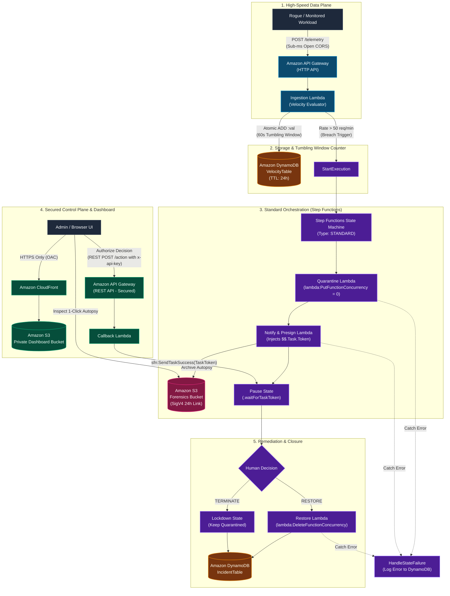

# KillSwitch Zero: System Architecture Specification

> **Project Name:** KillSwitch Zero  
> **Classification:** Cloud Circuit Breaker & Autonomous Blast-Radius Containment  
> **Core Objective:** Millisecond-level mitigation of runaway Lambda loops and recursive execution storms, scaling to absolute zero ($0.00 idle cost).

---

## 1. End-to-End System Architecture Diagram

---

## 2. Component Specifications & Boundaries

| Component | AWS Resource | Role & Configuration | Security Posture |
| :--- | :--- | :--- | :--- |
| **Data Plane API** | `AWS::Serverless::HttpApi` | Ultra-low latency endpoint (`POST /telemetry`) ingesting synthetic workload metrics. | Open CORS (`*`) for simulation flexibility. |
| **Ingestion Engine** | `AWS::Serverless::Function` | Python 3.12. Atomic `UpdateItem` on DynamoDB tumbling window. Triggers Step Functions on breach. | Scoped to `dynamodb:UpdateItem` and `states:StartExecution`. |
| **Tumbling Counter** | `AWS::DynamoDB::Table` | PK: `FunctionName`, SK: `Window_Minute`. Atomic counter with **24-hour native TTL** auto-purge. | On-Demand billing (`PAY_PER_REQUEST`). $0 idle cost. |
| **State Machine** | `AWS::Serverless::StateMachine` | `Type: STANDARD`. Orchestrates emergency brake, `.waitForTaskToken`, and branch execution. | Native `Catch` blocks on all task states preventing hang-ups. |
| **Emergency Brake** | `AWS::Serverless::Function` | Calls `lambda:PutFunctionConcurrency(Reserved=0)` to freeze rogue function in <200ms. | Inline IAM policy scoped strictly to target function ARN. |
| **Autopsy Generator** | `AWS::Serverless::Function` | Writes JSON post-mortem to S3; generates 24-hour **SigV4 Pre-signed URL**. | Scoped to `s3:PutObject` on forensic bucket. |
| **Control Plane API** | `AWS::Serverless::Api` | REST API handling `POST /action` and `GET /status`. | **Enforced API Key (`x-api-key`)** to block unauthorized resume. |
| **Static Edge UI** | `AWS::CloudFront::Distribution` | Global CDN fronting private S3 bucket with **Origin Access Control (OAC)**. | Forced HTTPS (`redirect-to-https`). No public S3 access. |

---

## 3. The 5-Step Lifecycle of a Quarantine

1. **Normal Flow:** Monitored Lambda processes jobs; background telemetry emits counts to `POST /telemetry`. DynamoDB counts sit well below 50 req/min.
2. **Breach Event:** A recursive loop or runaway queue consumer bursts 100+ requests. The tumbling window counter atomically crosses the 50 req/min threshold.
3. **Sub-Second Containment:** Ingestion Lambda fires Step Functions $\rightarrow$ Quarantine Lambda calls `PutFunctionConcurrency(Reserved=0)`. All subsequent invocations immediately fail with HTTP 429.
4. **Human-in-the-Loop:** Step Functions writes the autopsy to S3, generates a SigV4 pre-signed URL, and pauses on `.waitForTaskToken` at **$0 compute cost**.
5. **Resolution:** Admin reviews the autopsy in the dashboard and clicks "Authorize Restore" $\rightarrow$ Control Plane calls `SendTaskSuccess` $\rightarrow$ Step Functions unclamps concurrency via `DeleteFunctionConcurrency`.
